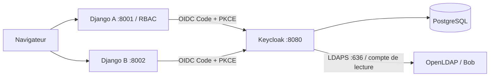

# Enterprise IAM Lab — Keycloak, Django et OpenLDAP

Laboratoire IAM sur Debian 13 (8 Go, 4 cœurs), développé pour apprendre et démontrer l’authentification fédérée, le SSO, le MFA et le contrôle des accès. Données fictives uniquement. **Ce dépôt est un laboratoire local, pas une plateforme de production ni une solution PAM.**

## Architecture



A et B utilisent des sessions, bases et cookies distincts. Keycloak conserve les comptes locaux comme Alice, utilise TOTP et fédère les utilisateurs LDAP comme Bob. Les ports web sont liés à `127.0.0.1`. PostgreSQL et LDAP ne publient aucun port.

## Fonctionnalités et preuves

| Fonction | État |
|---|---|
| OIDC confidentiel, Authorization Code, PKCE S256 | Testé manuellement avec Alice |
| SSO entre deux applications | Testé manuellement |
| RBAC reader/manager, refus par défaut | Tests manuels et automatisés |
| Déconnexion Django + Keycloak | Testée ; pas de propagation aux autres sessions locales |
| MFA TOTP | Enrôlement et codes correct/incorrect testés ; récupération non testée |
| LDAP : lecture, protection userPassword, refus d’écriture | Testé manuellement avant ajout TLS |
| LDAPS et ACL | Testés dans un conteneur isolé avec CA vérifiée |
| Fédération automatisée, conteneurs Django | Code fourni ; recette d’intégration encore à exécuter |
| Sauvegarde / restauration isolée | Scripts fournis ; restauration complète non encore validée |

Voir [le bilan de validation](docs/09-validation-finale.md). Une implémentation ou un test simulé ne constitue pas une validation de bout en bout.

## Installation depuis un nouveau clone

Prérequis : Debian/Linux, Docker Engine et Compose, Python 3.13 avec venv, OpenSSL. Ne pas utiliser de données réelles.

```bash
python3 -m venv .venv
source .venv/bin/activate
python -m pip install -r requirements.txt
python scripts/init_env.py
sh scripts/generate_ldap_tls.sh
docker compose build ldap
docker compose up -d
```

Le fichier `.env` généré et les clés dans `certs/` sont privés et ignorés par Git. **Pour un laboratoire déjà existant**, conserver `.env`, lancer `python scripts/init_env.py --extend`, générer les certificats s’ils sont absents, puis reconstruire LDAP et recréer Keycloak/LDAP pour appliquer TLS. Aucun volume à supprimer.

Quand Keycloak répond sur `http://localhost:8080`, provisionner :

```bash
python scripts/provision_keycloak.py
```

Le script demande le mot de passe du compte initial `lab-admin` (`KC_BOOTSTRAP_ADMIN_PASSWORD`). Il configure les clients et secrets depuis `.env`, les rôles, Alice, LDAPS en lecture seule et crée `iam-admin`. Sur un environnement existant, les mots de passe utilisateurs et OTP sont conservés : les nouvelles valeurs générées ne remplacent pas ces identifiants. Le script actualise les secrets des deux clients : garder les applications et `.env` cohérents.

Pour retirer le compte initial après vérification de `iam-admin` :

```bash
python scripts/provision_keycloak.py --admin iam-admin --retire-bootstrap
```

Le mot de passe permanent est `KC_PERMANENT_ADMIN_PASSWORD`. Le script le teste avant suppression du compte initial. La suppression explicite ne remplace pas un test manuel de la console d’administration.

## Démarrer les applications

```bash
python app/manage.py migrate
python app_b/manage.py migrate
python app/manage.py runserver 127.0.0.1:8001
# Dans un second terminal, avec le même venv actif :
python app_b/manage.py runserver 127.0.0.1:8002
```

Ouvrir `http://localhost:8001/login/`, puis `http://localhost:8002/login/` dans le même navigateur. Au premier enrôlement neuf, Alice doit configurer TOTP. Le provisioning fournit le rôle `reader` à Alice. Bob reste sans rôle applicatif : authentifié, il doit être refusé sur les pages RBAC de A.

Variante conteneurisée **Linux uniquement**, après arrêt des serveurs Django manuels :

```bash
docker compose -f compose.yaml -f compose.apps.yaml --profile apps up -d --build
```

Le réseau hôte conserve l’issuer `localhost` dans le navigateur et les conteneurs. Chaque serveur écoute seulement sur la boucle locale ; les bases utilisent des volumes séparés. Cette variante reste en serveur de développement et démarre des bases Django neuves, sans copier les bases locales.

## Vérifier et exploiter

```bash
sh scripts/validate.sh
```

La CI effectue les contrôles Django, les tests, la validation Compose et la construction LDAP. Les tests de configuration de fédération ne contactent pas Keycloak. Voir [LDAP/TLS](docs/07-ldap-federation.md), [exploitation et sauvegardes](docs/08-exploitation.md), [modèle de menaces](docs/10-securite.md).

## Budget et limites

Mesure utilisateur avant ajout LDAP : Keycloak ≈605 Mio, PostgreSQL ≈68 Mio. Limites : Keycloak 1,5 Gio, PostgreSQL 512 Mio, LDAP 256 Mio, Django conteneurisé 256 Mio par application. Ces limites ne sont pas des réservations ni des garanties sous charge.

OIDC reste en HTTP local. Avant production : HTTPS sur toute la chaîne, serveur WSGI/ASGI adapté, secrets gérés hors variables Docker, mises à jour et images fixées par digest, MFA des administrateurs, récupération testée, audit, limitation des privilèges et tests de charge. Les sessions Django expirent après 15 minutes ; les rôles sont un instantané de connexion et leur révocation n’est pas immédiate. `DEBUG` est désactivé par défaut.
